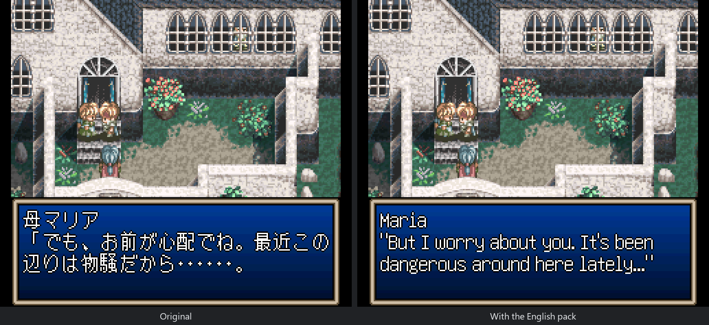
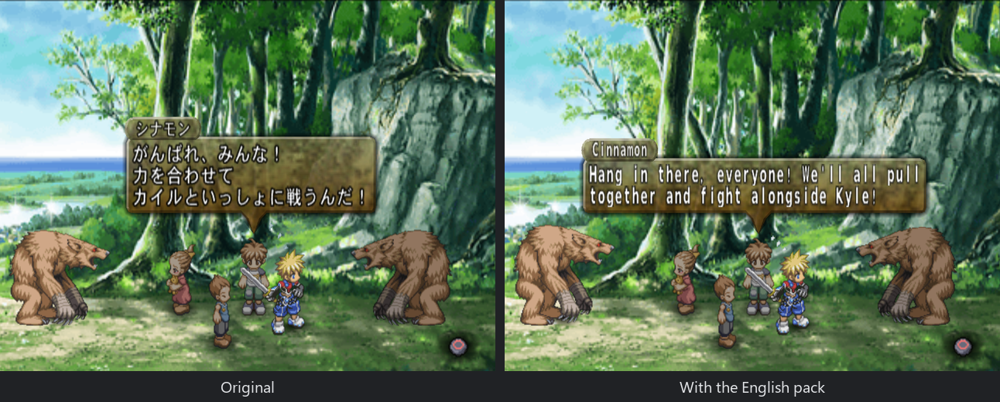

# ventris packs

Translation packs for [ventris](https://github.com/bquenin/ventris), a program that takes the text out of a
game and puts a translation back in. A pack is a folder of text: the strings of a game that a translation
changes, and a `pack.toml` that says what the pack is. With your own copy of the game and a pack, the
ventris app builds the translated game.

**This repository holds no game.** No game file, no game's script, no built image, no patch made from one.
To play a translation, or to work on one, you need your own copy of the game, in the release its adapter
was made for (the app names it on the game's page).

## The packs

| Game | Language | Folder | Version | How it was made | Seen on screen |
| --- | --- | --- | --- | --- | --- |
| Tales of Phantasia (Super Famicom, Japan) | English | [`top-sfc/en`](top-sfc/en) | 0.9.1 | Machine translated, directed by bquenin; not yet reviewed by a human translator | Parts: the main menu and most menu screens, battles on the world map and in the forest, the opening scene, a hunt early in the game, one long passage, and the eight lines shown as sprites. Most of the dialogue has only been built. |
| Tales of Destiny 2 (PlayStation 2, Japan, version 1.01) | English | [`tod2-ps2/en`](tod2-ps2/en) | 0.1 | Machine translated, directed by bquenin; not yet reviewed by a human translator | The opening, ten skits, the menus, a shop, the first battle and a quiz book. Nothing past Cresta. |
| Tales of Destiny 2 (PlayStation 2, Japan, version 1.01) | French | [`tod2-ps2/fr`](tod2-ps2/fr) | 0.1 | Machine translated from the Japanese, directed by bquenin; not yet reviewed by a human translator. The story, the menus, the lists, all the skits, the quiz books and the minigames; the kana answers of five minigames and two minigames stay Japanese, as in the English pack | The opening, the first town, the first steps on the world map, three skits, the menus, a shop and two battles. Nothing past the world map outside Cresta. |



Tales of Phantasia: the original on the left, the game built with the English pack on the right.



Tales of Destiny 2: the original on the left, the game built with the English pack on the right.

Tales of Phantasia's pack is the whole game in text: all the dialogue, the menus, the captions of battles
and menu screens, and the characters' names. Tales of Destiny 2's is a first full pass: the dialogue of
every story script from the prologue to the ending, 608 skits, the menu screens, the messages of the battle
program, the enemy names, the lists of artes, items, titles, recipes, shops and places, and the quiz books
and minigames. Both build with nothing refused.

Each pack's `NOTES.md` holds the names and terms it chose, how its strings are written, and exactly what
has and has not been seen on screen.

## Working samples, machine translated

**Both packs are machine translated and have not been reviewed by a human translator.** They are working
samples: they show that ventris carries a whole game, from the dialogue to the menus and lists, and they
are playable as far as has been seen. Expect lines that are mostly right, sometimes stiff, now and then
wrong, and here and there too long for the box the game gives them.

The work on a pack is done in plain text files, in any language and any alphabet, with no programming and
no hacking of the game. Anyone is free to improve these packs, or to write one of their own. If you see a
line that is wrong while playing, [open an issue](https://github.com/bquenin/ventris-packs/issues/new/choose)
that says where it is, what it says and what it should say, or fix it yourself in the browser.
[Translating a game](https://github.com/bquenin/ventris/blob/main/docs/translating.md) explains each way
to do it, from fixing one line to reviewing a part of a game or starting a pack in a new language.
[CONTRIBUTING.md](CONTRIBUTING.md) has the rules for a pack here.

## Using a pack

Get the ventris app from its [Releases page](https://github.com/bquenin/ventris/releases). It is a window
and needs no terminal, and there is nothing to download from here: each time it starts, the app gets the
packs from this repository by itself and keeps a copy. It lists the packs for each of your games and builds
the game with the one you choose.
[Playing a translated game](https://github.com/bquenin/ventris/blob/main/docs/playing.md) goes through it
step by step.

A copy of this repository on your computer is for working on a pack, or for the command line. Get it with
**Code**, then **Download ZIP**, and unpack it, or clone it with git. The ZIP unpacks to a folder named
`ventris-packs-main`, a clone to `ventris-packs`. To try a change in the app, choose the game, then
**Make a translation**, and under **Your pack** choose that folder, or the pack's own folder in it, with
**Choose your pack's folder…**; the app reads that game's pack from it and builds the game from it.
[Translating a game](https://github.com/bquenin/ventris/blob/main/docs/translating.md) says more.

For adapter authors and for scripts, the same Releases page has a command-line program, `ventris`, which
reads the packs from such a folder and which
[Commands](https://github.com/bquenin/ventris/blob/main/docs/commands.md) describes.

## Layout

One folder per game, named by the id of the game's adapter as `ventris games` shows it, and in it one
folder per language, named by its tag:

```text
tod2-ps2/
  en/
    pack.toml        what the pack is
    NOTES.md         the names and terms chosen, and what has been seen on screen
    06816.txt        the strings it changes, one file per section
```

## What a pack here may hold

Text written by its authors, and nothing else: the script files, `names.txt` where the game has one,
`pack.toml`, and notes. The letters a translation needs are drawn from fonts built into `ventris`, which
each game's adapter names, and a pack's `pack.toml` may name another of the built-in fonts.

The program can also build a pack that carries a font file of its own, but such a pack is not taken here. If
none of the built-in fonts draws a language well, propose a font for `ventris` itself: every pack in that
language then has it, and its licence is checked once.

Never the game's file, a script extracted from it, a built image, a patch made from one, or another
translation's text that its licence does not let you use. The format of a pack is described in full in the
engine's [docs/packs.md](https://github.com/bquenin/ventris/blob/main/docs/packs.md).

## Acknowledgements

An existing fan translation served as a reference while Tales of Phantasia was taken apart for ventris:
comparing a translated game with the original shows where the text is kept and what a longer line needs. It
is the English translation by DeJap (version 1.2, 2001).

It was used for facts only. No wording in these packs is taken from it.

## Licence

The packs in this repository are under the Creative Commons Attribution-NonCommercial-ShareAlike 4.0
International licence (CC BY-NC-SA 4.0), in [LICENSE](LICENSE). In plain words: you may copy the packs,
change them and pass them on, as long as you credit their authors, do not use them or what you make from
them commercially, such as by selling them, and pass on what you build on them under these same terms. The
licence itself is what holds; this is a summary.

Beyond the licence, the packs' authors welcome showing the translated games in videos and streams, whether
or not the video or stream earns money.

The licence covers only what the packs' authors wrote: their translation, their notes. Nothing in it grants any
right in a game or in a game's own text, which stay with their rights holders.
